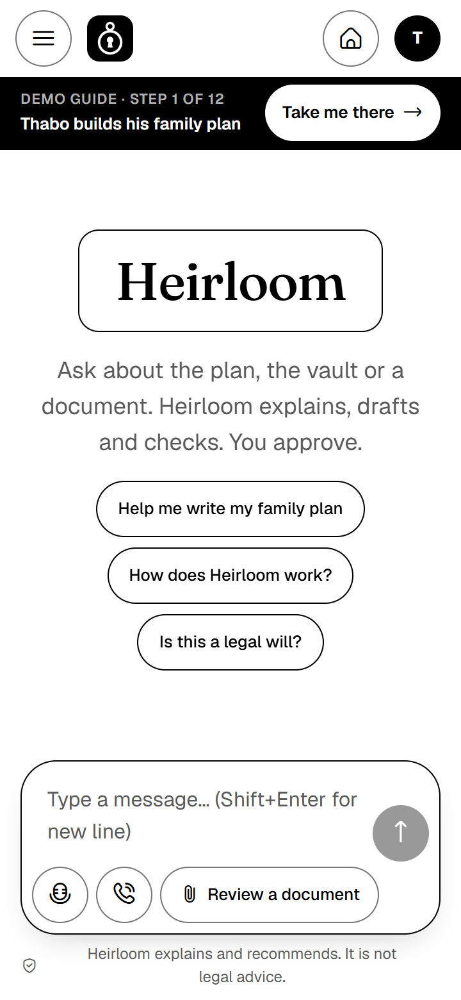
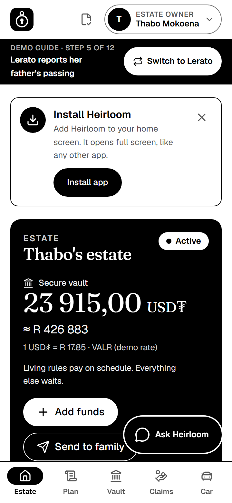
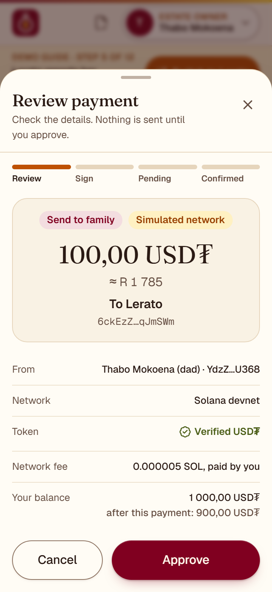
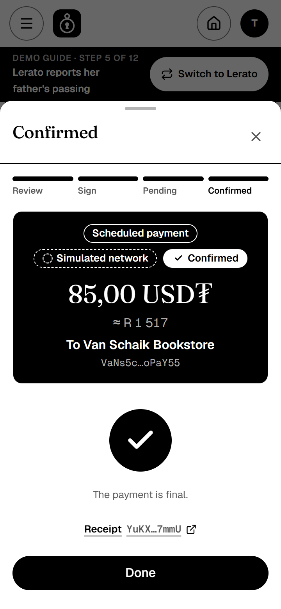
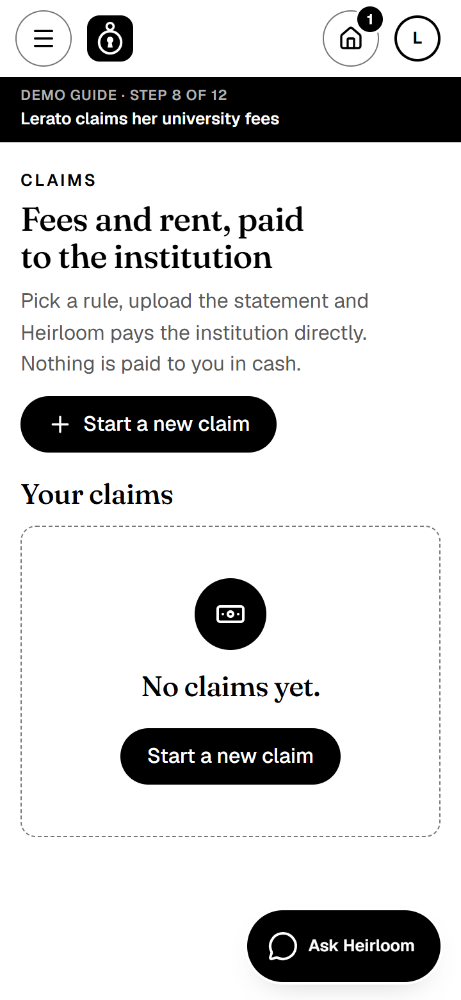
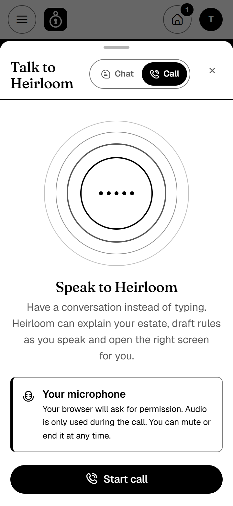
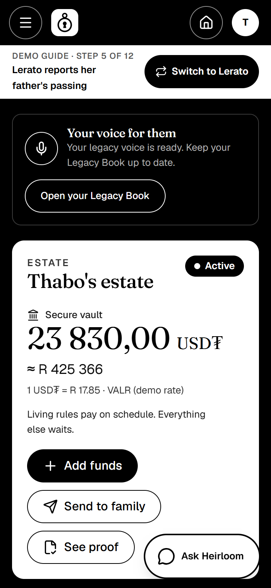
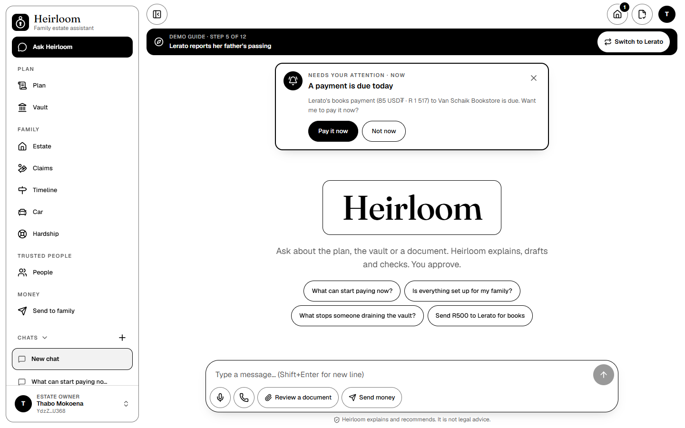
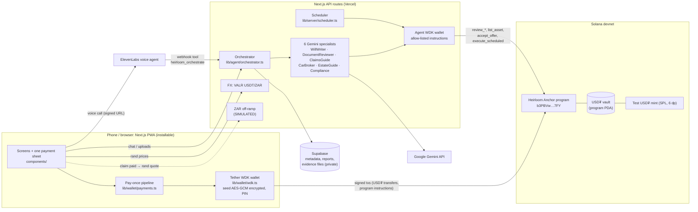

# Heirloom

**A living estate plan in USD₮: pay your children's school fees, allowances and family today, and keep
paying them after you're gone, under rules a Solana program enforces and Tether WDK wallets sign.**

> W3Node Node Engine Hackathon, Cape Town, November 2026 · **Tether track: Mobile Money & Peer-to-Peer**

**The problem.** 66% of South Africans have no will ([Sanlam Legacy Wills Survey 2025, via TimesLIVE](https://www.timeslive.co.za/news/south-africa/2025-09-19-66-of-south-africans-risk-family-feuds-by-dying-without-wills-sanlam-survey/)).
When a parent dies, the estate freezes: a simple estate used to take 6–9 months to wind up and now takes about
twice as long ([Moneyweb / The Citizen, Dec 2024](https://www.citizen.co.za/business/winding-up-of-estates-in-sa-in-shambles)).
The money for next term's fees exists. It just can't reach the school, and when it finally arrives as a lump sum,
nothing makes sure it is spent on the children.

| | |
|---|---|
| **Live demo** | **https://heirloom-one-iota.vercel.app** *(works on a phone; installable as an app)*. Runs in **mock mode**: the whole story is simulated in your browser with "Simulated" badges, and the agent gives labelled canned answers (no Gemini or ElevenLabs keys on the hosted demo). The on-chain proof is in the devnet links below |
| **Demo video (≤ 3 min)** | <!-- VIDEO_URL --> *(link added at submission)* |
| **Pitch deck** | [`docs/pitch.md`](docs/pitch.md) |
| **Program on devnet** | [`b3PBVwkLnyx7eyLPNtc5J3Ds3os3cenqCVRHaCJM7FY`](https://explorer.solana.com/address/b3PBVwkLnyx7eyLPNtc5J3Ds3os3cenqCVRHaCJM7FY?cluster=devnet) |
| **Real WDK USD₮ transfer** | [`nNUMsVDq…D6DvBEpKSCj`](https://explorer.solana.com/tx/nNUMsVDqmAbHxKYqTVXz1kggi2wfYXJawGod7gsXFpsysXFxBpnKG1vdL7m26UCm7hxwLc7cnDxpD6DvBEpKSCj?cluster=devnet) |
| **Tests** | 25/25 program tests (LiteSVM) · 230/230 app tests (Vitest) |

---

## What it does, in 60 seconds

The app opens on a **chat home** (`/chat`): "Needs your attention" cards (a payment that is due, a claim to approve,
a passing to confirm) above a composer where you can type, **Dictate**, call (**Call Heirloom**), **Review a document**
or **Send money**. A sidebar groups the screens (Plan, Family, Trusted people, Money), keeps your saved chats per
person, collapses to an icon rail on desktop and becomes a drawer on phones.

1. **Write the plan with an AI agent.** On the **Plan** screen, Thabo types his wishes in plain language. The agent turns them into strict
   rules: who gets what, for which purpose, paid to which institution, with a cap per claim and per lifetime.
   Each rule is set to **Now** (a living plan, running today) or **After I'm gone**. He reviews it in plain language
   and taps **Sign and lock** with his Tether WDK wallet.
2. **Fund the vault in USD₮.** The money sits in a vault owned by the Heirloom Solana program, not by us.
3. **Living plan: it already works.** A monthly book allowance (85 USD₮, about R1,500) pays itself to the bookstore.
   His daughter Lerato can claim her university fees; the AI checks the fee statement, Thabo approves, and the
   program pays **the university, never cash**. Claim more than the cap and **the contract refuses**.
4. **The same plan continues after death.** A death claim needs an AI document check, 2 of 3 verifiers (including the
   executor from the paper will) and a waiting period during which the owner can veto. Then the rules simply keep
   running, with the verifiers taking Thabo's place as approvers.
5. **The car sells at a fair price.** Buyers escrow USD₮; the agent settles the best offer **at or above the floor**,
   swapping money and digital title atomically. Below the floor only with a sworn hardship affidavit and 2 verifiers,
   and never below the hardship floor.
6. **Send to family.** A plain peer-to-peer USD₮ send to a saved family member, with the full Tether review → approve →
   pending → confirmed flow, and pay-once protection if the connection drops. You can also type "Send R500 to Lerato
   for books" in the chat: the wallet assistant reads it and opens the same review sheet.

## Screenshots

Phone width (360px), pure black and white, light and dark:

| Chat home | Estate dashboard | Payment review | Payment confirmed |
|---|---|---|---|
|  |  |  |  |

| Claims | Talk to Heirloom | Dark mode | Desktop |
|---|---|---|---|
|  |  |  |  |

*Screenshots were taken just before the icons moved to Flaticon UIcons, so a few icons look slightly different in the
live app.*

---

## Where Tether is used

Every USD₮ movement in Heirloom is a **USD₮ SPL token transfer on Solana, signed by a Tether WDK wallet**
(`@tetherto/wdk-wallet-solana` 1.0.0-beta.20). Every role has a WDK wallet, including the AI agent.

| Touchpoint | What happens | Code | Proof on devnet |
|---|---|---|---|
| **WDK wallet per person** | Create or import a self-custodial wallet in the browser; seed encrypted on the device with a PIN (PBKDF2 → AES-256-GCM), never sent to a server | [`app/src/lib/wallet/wdk.ts`](app/src/lib/wallet/wdk.ts), [`crypto.ts`](app/src/lib/wallet/crypto.ts), [`store.ts`](app/src/lib/wallet/store.ts), [`context.tsx`](app/src/lib/wallet/context.tsx) | — |
| **Balance + fee quote** | WDK read-only account: `getTokenBalance(USD₮ mint)`, `getBalance()`, `quoteTransfer()` before every send | [`app/src/lib/service/chain.ts`](app/src/lib/service/chain.ts) (`reviewSend`) | — |
| **WDK signs every transaction** | Unsigned tx built in the app → WDK signs on the device (`signOnly` / `sendTransaction`) | [`app/src/lib/wallet/signer.ts`](app/src/lib/wallet/signer.ts), [`app/src/lib/chain/tx.ts`](app/src/lib/chain/tx.ts) | [WDK USD₮ transfer](https://explorer.solana.com/tx/nNUMsVDqmAbHxKYqTVXz1kggi2wfYXJawGod7gsXFpsysXFxBpnKG1vdL7m26UCm7hxwLc7cnDxpD6DvBEpKSCj?cluster=devnet) |
| **USD₮ vault** | Estate vault = USD₮ token account owned by the program PDA; `deposit` / `withdraw` use `transfer_checked` and reject any other mint (`WrongMint`) | [`programs/heirloom/src/instructions/setup.rs`](programs/heirloom/src/instructions/setup.rs) | [Demo estate](https://explorer.solana.com/address/JBdsDy67YBfpV8YAc2H1h7w95h8uJ2XUzTDh9vt34G9E?cluster=devnet) |
| **Purpose payouts** | Claims and scheduled payments move USD₮ vault → institution's wallet (university, residence, school, bookstore) | [`claims.rs`](programs/heirloom/src/instructions/claims.rs) | Estate history on Explorer |
| **Car sale escrow** | Buyers escrow USD₮ in a per-offer escrow; settlement swaps USD₮ ↔ title NFT in one transaction | [`sale.rs`](programs/heirloom/src/instructions/sale.rs) | Car title NFT [`F9FVooHE…`](https://explorer.solana.com/address/F9FVooHEzRu92UXDmeUTNK7c1Wxgxi6xwWBRjqub5fLm?cluster=devnet) |
| **Agent's own WDK wallet** | Server-side WDK wallet that may sign only an allow-list: `review_*`, `list_asset`, `accept_offer`, `execute_scheduled` | [`app/src/lib/agent/agent-wallet.ts`](app/src/lib/agent/agent-wallet.ts) | Agent [`261pQudaK…`](https://explorer.solana.com/address/261pQudaK5J4v1WCtcGjWidWU9ww3KyYC4TiU8jDsjNg?cluster=devnet) |
| **P2P "Send to family"** | Saved recipient → review → approve → WDK sends USD₮ (`transfer_checked`, creates the recipient's account if needed) | [`app/src/components/screens/send.tsx`](app/src/components/screens/send.tsx), `chain.ts` (`confirmSend`) | [50 USD₮ Dad → Lerato, sent through the app UI](https://explorer.solana.com/tx/25PK65L8bLSCM6d1jJMBTAAaW9UeyDjk8HBdCp5pBmk8MDGAwu8JpNzKXUYxhLnzPsZeGJNqQpjBxC2Q62ofJYvT?cluster=devnet) |
| **Families never need SOL** | The agent's WDK wallet sponsors network fees: the user's WDK wallet partially signs, `/api/sponsor` validates against a strict policy (USD₮ `transferChecked` + Heirloom instructions only), simulates, co-signs. Tether's gasless module needs a Kora paymaster server, so we sponsor ourselves | [`app/src/lib/sponsor/policy.ts`](app/src/lib/sponsor/policy.ts), [`app/src/app/api/sponsor/route.ts`](app/src/app/api/sponsor/route.ts) | [Sponsored transfer: Lerato's SOL unchanged](https://explorer.solana.com/tx/5NfaB421n92RHKJgcEiczMbDadP9zNo9yDZwgbXVFZyVZBxgYvQtWMdTt7GZWjt4GYpYZAx1pP97xJUY7HULkqVn?cluster=devnet) |
| **Tether QVAC: on-device AI** | "Ask your wallet": QVAC (`@qvac/sdk`, Qwen3 0.6B, JSON-schema output) turns "Send R500 to Lerato for books" into a checked payment intent on the user's own machine, with no cloud AI. The app matches the recipient, converts rand at the live VALR rate and opens the review sheet; money moves only after approval and a WDK signature. The hosted demo and offline phones use a deterministic parser with the same schema, and a badge says which engine answered | [`app/src/lib/assistant/`](app/src/lib/assistant/), [`docs/qvac.md`](docs/qvac.md) | Run locally: `npm run qvac:install`, then `npm run qvac:local -- "send R500 to Lerato"` |
| **Devnet setup** | 13 persona wallets created and funded with WDK `transfer` (SOL and USD₮) | [`scripts/devnet-setup.ts`](scripts/devnet-setup.ts) | Test USD₮ mint [`8qp8uFHe…`](https://explorer.solana.com/address/8qp8uFHeJMgwQPWCYAKh9mpYw6FgU4iwu6psKiKViKK5?cluster=devnet) |
| **Rand view** | Every USD₮ amount also shown in ZAR at the live VALR USDT/ZAR price | [`app/src/lib/fx.ts`](app/src/lib/fx.ts) | — |

On devnet we use our own 6-decimal **test USD₮** mint (devnet has no official USD₮). Each estate stores its mint, and
the app verifies the mint (exists, 6 decimals, matches the configured USD₮) before any send. Mainnet USD₮
(`Es9vMFrzaCERmJfrF4H2FYD4KCoNkY11McCe8BenwNYB`) is a one-line config change.

## The track's payment flow, step by step

Every USD₮ movement, P2P or from the vault, goes through **one** payment sheet:
[`app/src/components/pay/payment.tsx`](app/src/components/pay/payment.tsx) on top of the pay-once pipeline in
[`app/src/lib/wallet/payments.ts`](app/src/lib/wallet/payments.ts).

| Tether brief | Heirloom | Where |
|---|---|---|
| Check the address, the network and the token | Valid Solana address; not your own; warning if it is a program account (off-curve); the USD₮ mint must exist on this cluster with 6 decimals **and** equal the configured mint, or the send is blocked | `service/chain.ts` → `reviewSend`, `confirmSend` |
| Check the balance and get a fee quote | WDK `getTokenBalance`, `getBalance`, `quoteTransfer`; adds rent if the recipient needs a USD₮ account; flags "not enough USD₮ / SOL" | `service/chain.ts` → `reviewSend` |
| Show recipient, amount, fee and network; approve or cancel | Review sheet: recipient name + short address, amount in USD₮ **and** rand, network, fee and who pays it, verified-token badge, warnings; Approve / Cancel | `components/pay/payment.tsx` |
| The wallet signs and submits | "Signing with your Tether wallet (WDK)". We **sign first, store the signature, then broadcast**, so the payment id is bound to one signature | `wallet/payments.ts` → `runPayment` |
| Pending until the network confirms | Stepper Review → Sign → Pending → Confirmed; receipt with Solana Explorer link | `wallet/payments.ts` → `recheck`, `waitForFinal` |
| Poor-connection resilience | Open payments are re-checked on load, on `online` and when the tab becomes visible. Same signed bytes may be re-broadcast while the blockhash is valid (cannot pay twice); after expiry it is marked "not paid, safe to retry". A payment with a signature is **never re-signed** | `wallet/payments.ts` → `resumeOnReconnect`; offline bar in `payment.tsx` |
| Show what goes wrong and how to get unstuck | Program errors are decoded into plain language ("Rejected by the Heirloom program: ExceedsPerClaimCap") with the next step, and the agent can explain why | `wallet/wdk.ts` → `explainSendError`; `components/shell/blocked.tsx` |
| Label simulated parts | "Simulated" badges on mock-mode receipts, the ZAR settlement and the scripted call preview | `content/pay.ts`, `content/screens.ts` |

---

## Architecture



Deeper diagrams (sequence diagrams for every money path) are in [`docs/architecture.md`](docs/architecture.md).

### Key design decisions

- **The AI recommends; the contract enforces.** Gemini writes rules, reads documents and ranks offers. Caps, payee
  types, end dates, floors, quorums and waiting periods are checked by the Solana program, so even a fully
  compromised agent cannot overpay, pay the wrong payee or sell below the floor. The agent's wallet can only sign an
  allow-list of instructions ([`agent-wallet.ts`](app/src/lib/agent/agent-wallet.ts)).
- **Only hashes on-chain (POPIA).** Death certificates, fee statements and affidavits stay off-chain in a private
  Supabase bucket; the chain stores their SHA-256 and the SHA-256 of the agent's report
  ([`lib/agent/hash.ts`](app/src/lib/agent/hash.ts), canonical JSON).
- **Pay institutions, not people.** Payouts go only to Payee accounts the owner approved, of the kind each rule
  allows (University, School, Landlord, Other).
- **One plan for life and after.** A `starts_now` rule runs while the owner is alive (owner approves claims); after
  unlock the verifier quorum approves. Scheduled payments run in both phases.
- **Self-custody everywhere.** Keys live in WDK on the user's device; Heirloom never holds them.
- **Always demoable.** `NEXT_PUBLIC_DATA_MODE=mock` (default) runs the whole story offline in one browser with a persona
  switcher; `chain` mode runs it on devnet with WDK signing. The same UI and service interface
  ([`lib/service/types.ts`](app/src/lib/service/types.ts)) serve both.
- **One brain for text and voice.** Chat and the ElevenLabs call both go through `/api/agent/orchestrate`.

## The on-chain program

Anchor 1.2.2 · [`programs/heirloom/`](programs/heirloom/) · full spec in [`docs/program-spec.md`](docs/program-spec.md)

**27 instructions** in five groups:

| Group | Instructions |
|---|---|
| Setup | `create_estate`, `set_will`, `add_beneficiary`, `add_payee`, `add_rule`, `deposit`, `withdraw`, `heartbeat`, `register_asset` |
| Death | `submit_death_claim`, `review_death` (agent), `attest_death` (verifiers), `veto_death` (owner), `finalize_unlock` |
| Claims | `submit_claim`, `review_claim` (agent), `approve_claim` (verifiers), `owner_approve_claim` (living plan), `execute_claim` |
| Scheduled | `execute_scheduled` (anyone may call once due; the program decides) |
| Car sale | `list_asset`, `place_offer`, `withdraw_offer`, `submit_hardship`, `review_hardship`, `approve_hardship`, `accept_offer` |

**Guarantees the program enforces** (each has a test):
- Only the estate's USD₮ mint is accepted (`WrongMint`).
- A claim must be by the rule's beneficiary, to a payee of the rule's kind, within the per-claim cap, the lifetime cap
  (re-checked at payout) and the end date (`ExceedsPerClaimCap`, `ExceedsLifetimeCap`, `WrongPayeeKind`, `RuleExpired`).
- No payout without the agent's approval **and** the owner (while alive) or the verifier quorum (after unlock)
  (`AgentNotApproved`, `InsufficientApprovals`).
- Unlock needs an agent-approved death claim, `death_threshold` verifier attestations and the waiting period; the
  owner can veto until then (`WaitingPeriodNotOver`).
- Scheduled payments go only to the rule's fixed payee, only when due, within caps (`NotDue`, `ExceedsLifetimeCap`).
- The car sells only at or above the floor; below it only to an approved hardship beneficiary and never below the
  hardship floor (`BelowFloor`, `BelowHardshipFloor`). USD₮ and title NFT swap atomically.

**Tests:** 25 LiteSVM tests in [`programs/heirloom/tests/heirloom.rs`](programs/heirloom/tests/heirloom.rs), e.g.
`claim_over_per_claim_cap_fails`, `lifetime_cap_rechecked_at_execution`, `death_flow_unlocks_after_quorum_and_waiting_period`,
`offer_below_floor_rejected_and_best_offer_settles_atomically`, `scheduled_payment_pays_when_due_and_stops_at_lifetime_cap`,
`living_plan_claim_needs_owner_approval_while_active`.

## What's real and what's simulated

| Part | Status |
|---|---|
| Heirloom Solana program (27 instructions) | **Real**, deployed to devnet, 25/25 tests. **Not audited.** |
| USD₮ transfers signed by Tether WDK wallets (owner, family, verifiers, buyers, agent) | **Real** on devnet (chain mode) |
| USD₮ token | **Test mint** on devnet (6 decimals, same as USD₮); mainnet mint is a config change |
| Pay-once payment pipeline, reconnect re-check | **Real** (unit-tested in `payments.test.ts`) |
| AI agent (Gemini orchestrator + 6 specialists) | **Real** with `GEMINI_API_KEY`; without it, clearly labelled canned answers |
| Voice call (ElevenLabs) | **Real** with ElevenLabs keys; otherwise a labelled "Simulated call preview" |
| Legacy voice (parent's cloned voice, ElevenLabs IVC + TTS + private agent) | **Real** with `ELEVENLABS_API_KEY` in chain mode (or a demo deploy with `LEGACY_DEMO_WRITES=1`); otherwise the browser's voice stands in, labelled "Simulated voice" |
| USD₮ → ZAR rate | **Real**, live VALR public ticker (fallback rate labelled) |
| Rand settlement to the university (PayShap/EFT) | **Simulated** and labelled ([`lib/offramp.ts`](app/src/lib/offramp.ts)). Next step: a licensed partner |
| Institutions (UCT, residence, school, bookstore) | **Demo wallets** we control, not the real institutions |
| Death certificate, fee statement, affidavit | **Sample documents** marked SAMPLE |
| Waiting period and payment intervals | **60 seconds** for the demo instead of weeks / months |
| Mock mode (default) | Whole story **simulated** in the browser, with a "Simulated" badge; Explorer will not find mock receipts |
| Hosted demo (heirloom-one-iota.vercel.app) | **Mock mode**, with no Gemini, ElevenLabs or Supabase keys: canned agent answers and the simulated call preview, both labelled. The devnet links in this README are the on-chain proof |

## Run it locally

### Mock mode (no keys, no chain): 3 commands

Needs Node.js 20.9+.

```bash
git clone https://github.com/TUMO-MOGAME/W3Node-Hackathon.git
cd W3Node-Hackathon/app && npm install
npm run dev
```
Open <http://localhost:3000> → **Try the demo** → **Start as Thabo**. You land on the chat home; the demo guide bar
(**Take me there**, **Switch to …**) and **Demo mode** in the sidebar (persona switcher and demo controls) walk you
through the story.

### Chain mode (Solana devnet + Tether WDK)

```bash
cd app
cp .env.example .env.local          # then edit, see below
# create your own persona wallets, test USD₮ mint and car NFT (needs ~2 devnet SOL from faucet.solana.com)
npx tsx --tsconfig ../scripts/tsconfig.json ../scripts/devnet-setup.ts
# copy the printed lines from scripts/.env.devnet into app/.env.local, then seed a demo estate
npx tsx --tsconfig ../scripts/tsconfig.json ../scripts/seed-demo.ts
npm run dev
# optional: run scheduled payments every 20 s
npx tsx --tsconfig ../scripts/tsconfig.json ../scripts/run-scheduler.ts http://localhost:3000
```
The program is already deployed, so you don't need the Rust toolchain. Import each persona's seed (from the
gitignored `scripts/.demo-wallets.json`) in the app's wallet screen. Details: [`scripts/README.md`](scripts/README.md).

### Environment variables

All names are in [`app/.env.example`](app/.env.example). Only `NEXT_PUBLIC_*` reach the browser.

| Variable | Needed for | Notes |
|---|---|---|
| `NEXT_PUBLIC_DATA_MODE` | all | `mock` (default) or `chain` |
| `NEXT_PUBLIC_SOLANA_CLUSTER`, `NEXT_PUBLIC_SOLANA_RPC_URL` | chain | `devnet`; custom RPC optional |
| `NEXT_PUBLIC_HEIRLOOM_PROGRAM_ID` | chain | `b3PBVwkLnyx7eyLPNtc5J3Ds3os3cenqCVRHaCJM7FY` |
| `NEXT_PUBLIC_USDT_MINT` | chain | devnet test mint `8qp8uFHeJMgwQPWCYAKh9mpYw6FgU4iwu6psKiKViKK5` or your own |
| `NEXT_PUBLIC_DEMO_WAITING_SECS`, `NEXT_PUBLIC_DEMO_INTERVAL_SECS` | demo | 60 s waiting period / payment interval |
| `AGENT_SEED_PHRASE`, `SOLANA_RPC_URL` | chain, server | the agent's WDK wallet; keep secret |
| `GEMINI_API_KEY`, `GEMINI_MODEL` | AI | without a key: labelled canned answers |
| `ELEVENLABS_API_KEY`, `ELEVENLABS_AGENT_ID`, `ELEVENLABS_TOOL_SECRET` | voice | setup in [`scripts/elevenlabs-agent.md`](scripts/elevenlabs-agent.md) |
| `ELEVENLABS_HEIRLOOM_VOICE_ID`, `ELEVENLABS_TTS_MODEL`, `LEGACY_SPEAK_SECRET`, `LEGACY_DEMO_WRITES` | legacy voice | §6 of [`scripts/elevenlabs-agent.md`](scripts/elevenlabs-agent.md); `LEGACY_DEMO_WRITES` is demo-only |
| `SUPABASE_URL`, `SUPABASE_SERVICE_ROLE_KEY` | storage | without them: in-memory store; schema in [`supabase/migrations/0001_init.sql`](supabase/migrations/0001_init.sql) |
| `SCHEDULER_SECRET`, `CRON_SECRET` | scheduled payments | protects `POST /api/scheduler/tick` |
| `FX_FALLBACK_USDT_ZAR` | FX | used only if VALR is unreachable |

### Scripts

| Script | What it does |
|---|---|
| [`scripts/devnet-setup.ts`](scripts/devnet-setup.ts) | WDK persona wallets, funding, test USD₮ mint, car title NFT, writes `scripts/.env.devnet` |
| [`scripts/seed-demo.ts`](scripts/seed-demo.ts) | Creates the demo estate (verifiers, beneficiaries, payees, rules, deposit, car). Idempotent |
| [`scripts/run-scheduler.ts`](scripts/run-scheduler.ts) | Calls the scheduler every 20 s so living-plan payments run by themselves |
| [`scripts/build-program.sh`](scripts/build-program.sh) | Builds, tests and (optionally) deploys the program inside WSL Ubuntu |

## Tests

```bash
cd app && npm test                 # 230 Vitest tests: payments (pay-once), WDK errors, PDAs, IDL ↔ client, agent schemas,
                                   # offers, scheduler, hashing, fee-sponsor policy, QVAC intent parser, chat, legacy voice, i18n, icons
cd app && npx tsc --noEmit         # type check
anchor build && cargo test -p heirloom   # 25 LiteSVM program tests (Linux / WSL, Anchor 1.2.2)
```
`bash scripts/build-program.sh test` does the same inside WSL: it copies the program to the Linux disk for a faster build, then runs the tests.

## Security notes

- **Keys:** seeds never leave the device; encrypted at rest with a 6+ digit PIN (PBKDF2-SHA256, 310k iterations →
  AES-256-GCM). The agent's seed is server-only and its wallet signs only allow-listed instructions.
- **Contract first:** every money rule is on-chain; the UI and the AI are convenience, not security.
- **Mint pinning:** the program rejects any token account that is not the estate's USD₮ mint; the app verifies the mint
  before every send.
- **Pay once:** signatures are persisted before broadcast; a payment is never re-signed.
- **Web:** HTTPS with HSTS and a Content-Security-Policy ([`app/next.config.ts`](app/next.config.ts)); per-IP rate limits and
  zod-validated bodies on API routes ([`lib/api/http.ts`](app/src/lib/api/http.ts)); scheduler and voice webhook protected by
  shared secrets; Supabase tables have RLS on with no public policies; evidence bucket is private.
- **Prompt injection:** uploaded documents are passed to the model as data, and the system prompt tells it to ignore
  instructions inside them. A manipulated verdict still can't break a cap or a quorum.
- **Legacy voice:** a parent's cloned voice is a fraud tool if misused, so: only the living owner can create it (recorded
  consent line + unticked box, estate must be Active); every `/api/legacy/*` request is signed by the WDK wallet
  (ed25519 over action, estate, time and body hash; 5-minute window, single use) and checked against the on-chain owner /
  beneficiaries; the ElevenLabs `voice_id` and agent id stay server-side (live calls use a private per-estate agent, so no
  client overrides); the voice only speaks owner-written milestones or companion replies carrying a server HMAC token,
  never arbitrary text; it has no tools and refuses money requests; distress steps out of character with SADAG helplines.
  See [`app/src/lib/legacy/`](app/src/lib/legacy/) and [`supabase/migrations/0002_legacy.sql`](supabase/migrations/0002_legacy.sql).
- **Known limits:** devnet only; not audited; in-memory rate limits (per instance); no seed-recovery flow yet.
- **Secrets:** `.env*`, keypairs and demo wallet seeds are gitignored. Report issues privately to the maintainer.

## Roadmap

| When | Next |
|---|---|
| Dec 2026 – Feb 2027 | Legal opinion (trust structure, FSCA position); security review; choose a licensed USD₮→ZAR partner |
| Mar – May 2027 | Pilot: 20 families, 5 executors, 3 institutions; rand payouts over PayShap / EFT |
| Jun – Aug 2027 | External audit; mainnet USD₮ with small caps; ID-bureau deceased check; executor dashboard; WDK gasless sends |
| Sep 2027 | Public launch (Wills Month); partner pilots |

We will approach an exchange, a licensed off-ramp, executor firms and burial societies; **none are partners yet**.
Business case: [`docs/business.md`](docs/business.md).

## Team

Solo project.

| Name | Role |
|---|---|
| Tumo Mogame | Founder: product, design, full-stack, Solana program |

## Pre-existing code disclosure

**None.** All code in this repository was written during the hackathon (10–13 November 2026). It uses the
open-source libraries listed below under their own licences.

| Area | Libraries |
|---|---|
| Wallets | `@tetherto/wdk-wallet-solana` (Tether WDK) |
| Solana | `anchor-lang` 1.2.2 (Rust), `@anchor-lang/core`, `@solana/web3.js`, `@solana/spl-token`, `@solana/kit`, LiteSVM (tests) |
| App | Next.js 16, React 19, Tailwind CSS 4, `motion`, `@flaticon/flaticon-uicons`, `clsx`, `zod` |
| AI and voice | `@google/genai` (Gemini), `@elevenlabs/react` |
| Data | `@supabase/supabase-js` |
| Tooling | TypeScript, Vitest, `tsx`, ESLint, `subset-font` |

## Credits

- Icons: [Uicons by Flaticon](https://www.flaticon.com/uicons) (Regular weight, Rounded style), used under the Flaticon free
  licence with attribution. The app ships only the glyphs it uses: `npm run icons` (also run before every build) subsets
  the font to about 11 KB.

## Licence

[MIT](LICENSE) © 2026 Tumo Mogame.

*Heirloom is a prototype on a test network. It is not a will, not financial or legal advice, and not audited. In South
Africa a will must still be signed on paper (Wills Act 7 of 1953); Heirloom sits next to it.*
