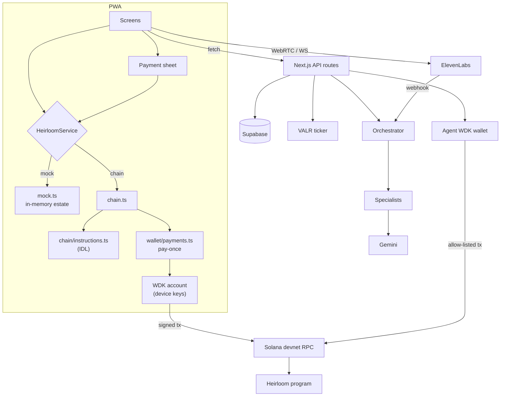
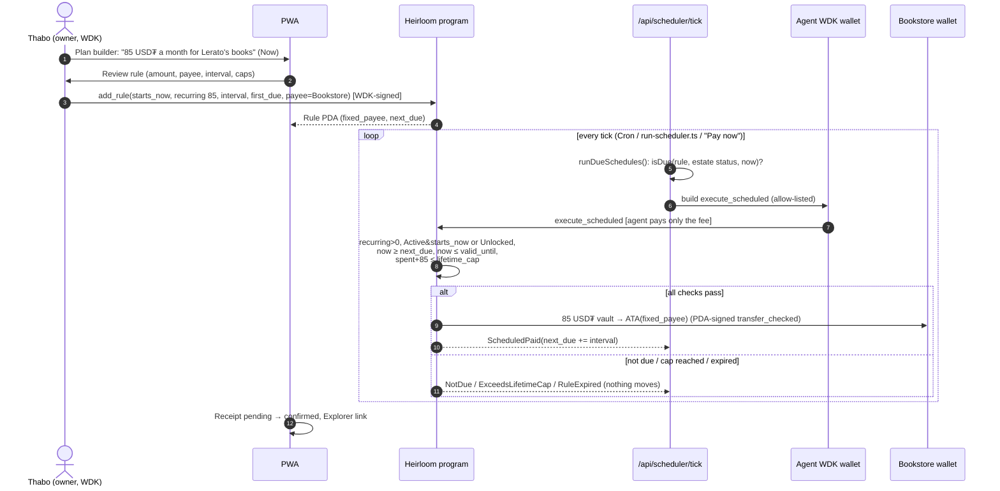
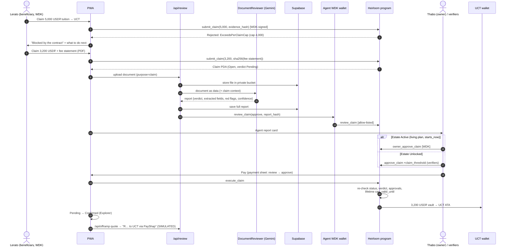
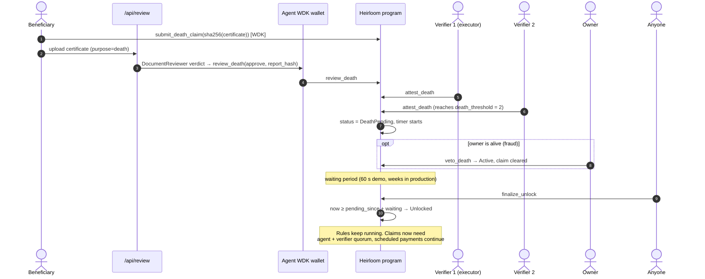
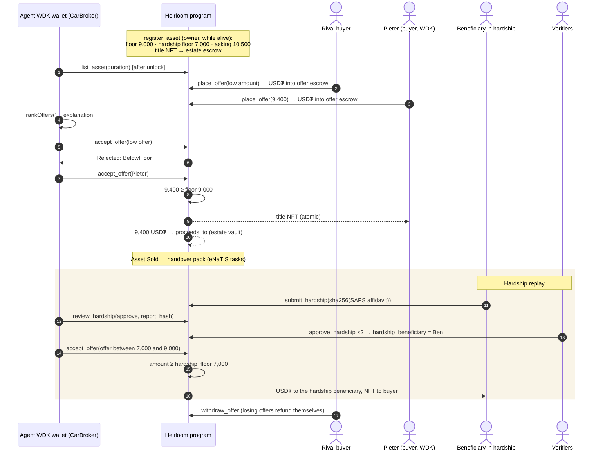
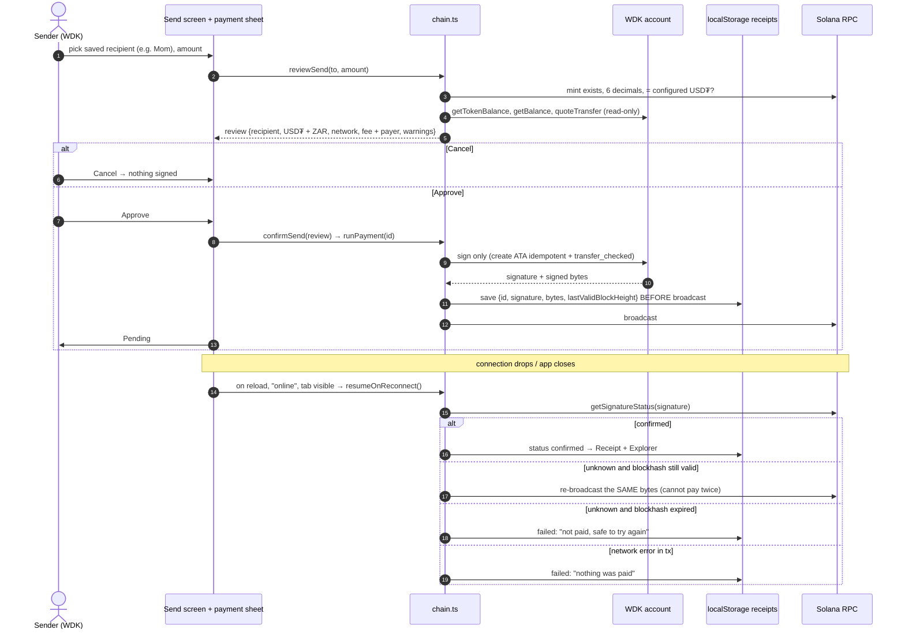
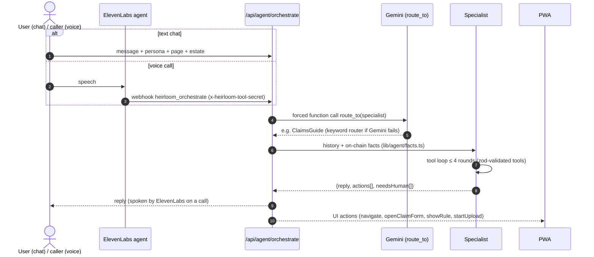

# Heirloom: architecture

> Companion to the [README](../README.md). The on-chain contract is specified in [`program-spec.md`](program-spec.md);
> this file explains how the pieces talk to each other, with a sequence diagram for every money path.
> Paths are relative to the repo root.

## 1. Components

| Layer | What | Where |
|---|---|---|
| **PWA (browser / phone)** | Next.js 16 App Router, React 19, Tailwind 4. Installable (manifest + service worker), offline page | `app/src/app/`, `app/src/app/manifest.ts`, `app/public/sw.js`, `app/src/components/shell/service-worker.tsx` |
| **Screens** | Estate, plan builder (will), vault, claims, car, hardship, people, inbox (verifiers), family, send (P2P), start | `app/src/components/screens/*.tsx` |
| **One payment sheet** | Review → Approve/Cancel → Signing (WDK) → Pending → Confirmed, for every USD₮ movement | `app/src/components/pay/payment.tsx` |
| **Service interface** | One `HeirloomService` with two implementations: `mock` (in-browser, default) and `chain` (Solana + WDK) | `app/src/lib/service/{types,index,mock,chain}.ts` |
| **Wallets** | Tether WDK (`@tetherto/wdk-wallet-solana`), PIN-encrypted seed in localStorage, active-signer singleton | `app/src/lib/wallet/{wdk,crypto,store,signer,context}.ts(x)` |
| **Pay-once pipeline** | Sign → persist signature → broadcast → re-check; resume on reconnect | `app/src/lib/wallet/payments.ts` (+ `payments.test.ts`) |
| **Chain client** | IDL-driven instruction builders (accounts resolved by name), PDAs, decoders, unsigned tx builder | `app/src/lib/chain/{instructions,pda,decoders,reads,tx,client,config}.ts`, `idl/heirloom.json` |
| **API routes** | Agent orchestrate, document review, valuation, offers, list/accept, scheduler tick, FX, off-ramp, reports, estate metadata, voice session | `app/src/app/api/**/route.ts`, shared guards in `app/src/lib/api/http.ts` |
| **AI agent** | Gemini orchestrator (forced `route_to` function call; keyword fallback) + 6 specialists with zod-typed tools | `app/src/lib/agent/{orchestrator,specialists,prompts,gemini,will,review,offers,valuation,facts}.ts` |
| **Agent wallet** | Server-side WDK wallet; allow-list `review_death`, `review_claim`, `review_hardship`, `list_asset`, `accept_offer`, `execute_scheduled` | `app/src/lib/agent/agent-wallet.ts` |
| **Scheduler** | Finds due recurring rules, calls `execute_scheduled` (agent pays only the fee) | `app/src/lib/server/scheduler.ts`, `POST /api/scheduler/tick`, `scripts/run-scheduler.ts` |
| **Voice** | ElevenLabs Agents Platform; webhook tool `heirloom_orchestrate` → our orchestrator; client tools → UI actions | `app/src/lib/voice/useHeirloomVoice.ts`, `app/src/app/api/voice/session/route.ts`, `scripts/elevenlabs-agent.md` |
| **Off-chain data** | Supabase Postgres (names, will drafts, full agent reports, transcripts) + private `evidence` bucket; in-memory fallback | `app/src/lib/{db,storage,supabase}.ts`, `supabase/migrations/0001_init.sql` |
| **FX** | VALR public USDT/ZAR market summary, mid price, 60 s cache, labelled fallback | `app/src/lib/fx.ts`, `/api/fx` |
| **ZAR off-ramp** | `SimulatedZarPayout`: describes the PayShap/EFT payout a licensed partner would make. **Simulated** | `app/src/lib/offramp.ts`, `/api/offramp` |
| **Program** | Anchor 1.2.2, 27 instructions, 25 LiteSVM tests | `programs/heirloom/src/**`, `programs/heirloom/tests/heirloom.rs` |

## 2. Trust boundaries

| Actor | Can | Cannot |
|---|---|---|
| Owner (WDK on device) | Create estate, rules, payees; deposit/withdraw while Active; approve living-plan claims; veto a death claim | Pay a claim the agent rejected; change rules after unlock |
| Beneficiary | Submit claims, a death claim, a hardship request | Choose the payee kind, exceed caps, get cash |
| Verifier (×3) | Attest death, approve claims after unlock, approve hardship, list an asset | Act alone below the threshold; approve living-plan claims while the owner is alive |
| AI agent (server WDK) | Approve/reject document reviews, list and settle the car sale, trigger due scheduled payments | Move vault money by itself, sign anything outside its allow-list, sell below the floor |
| Anyone | `finalize_unlock` after the waiting period, `execute_claim` once approved, `execute_scheduled` once due | Change where the money goes: the program decides the recipient |
| Heirloom (the company) | Host the app and the agent | Hold user keys, read documents on-chain (only hashes are there) |

## 3. Living-plan scheduled payment

A `starts_now` rule with `recurring_amount > 0` pays a fixed payee (here: the bookstore) every interval while the owner
is alive, and keeps doing so after unlock. The demo uses a 60 s interval and a manual **Pay now** button; in production
Vercel Cron calls the tick.

Why it is safe: the keeper (agent or anyone) only chooses *when* to call; amount and recipient are stored in the rule.
Wrong timing just fails. Code: `app/src/lib/server/scheduler.ts` (`isDue` mirrors the program), test
`scheduled_payment_pays_when_due_and_stops_at_lifetime_cap`, `scheduled_payment_waits_for_unlock_unless_starts_now`.

## 4. Claim with AI review and a contract cap

The AI never decides alone and never moves money: a rejected review blocks payment (`AgentNotApproved`), and an
approved one still needs the owner or the quorum. Tests: `claim_over_per_claim_cap_fails`,
`lifetime_cap_rechecked_at_execution`, `claim_to_wrong_payee_kind_fails`, `living_plan_claim_needs_owner_approval_while_active`.

## 5. Death and unlock

Four independent locks: AI check, 2-of-3 humans, a timer, an owner veto. Tests:
`death_flow_unlocks_after_quorum_and_waiting_period`, `veto_resets_death_claim`, `agent_rejection_clears_death_claim`,
`owner_cannot_approve_after_unlock`.

## 6. Car sale with floor and hardship

Tests: `offer_below_floor_rejected_and_best_offer_settles_atomically`,
`hardship_approved_allows_hardship_floor_and_pays_hardship_beneficiary`, `offer_below_hardship_floor_rejected`,
`withdraw_offer_refunds_buyer`, `offers_after_listing_end_rejected`.

## 7. P2P "Send to family" with pay-once resume

This is the Tether brief's flow end to end, including the poor-connection case.

Invariant: a payment id with a signature is never re-signed, so a retry can only re-send the identical transaction.
Unit tests in `app/src/lib/wallet/payments.test.ts`.

## 8. Agent: orchestrator and specialists

| Specialist | Job | Tools / code |
|---|---|---|
| WillWriter | Plain-language wishes → `WillDraft` (beneficiaries, verifiers, rules Now/After, car floors) | `lib/agent/will.ts` |
| DocumentReviewer | Death certificate / fee statement / affidavit → verdict + report hash | `lib/agent/review.ts` |
| ClaimsGuide | "How much can I claim?" from on-chain caps; prefilled claim form | `lib/agent/facts.ts` (`checkClaim`) |
| CarBroker | Valuation, asking price, offer ranking | `lib/agent/valuation.ts`, `offers.ts` |
| EstateGuide | Status, "why was this blocked?", next steps | `lib/agent/explain.ts` |
| Compliance | POPIA, Wills Act, FSCA questions; never legal advice | `lib/agent/prompts.ts` |

## 9. Data placement

| Data | Where | Why |
|---|---|---|
| Money, rules, caps, approvals, statuses | Solana program accounts | Enforced and auditable |
| SHA-256 of documents and agent reports | Solana | Proves the document/report wasn't changed, without revealing it |
| Documents (certificates, statements, affidavits) | Supabase private bucket | POPIA: personal information off-chain |
| Full agent reports, display names, transcripts | Supabase Postgres (RLS on, service role only) | Needed by the UI, not by the contract |
| Seed phrases | User's device only, PIN-encrypted | Self-custody |
| Pending payment receipts | Device localStorage | Pay-once resume without a server |
